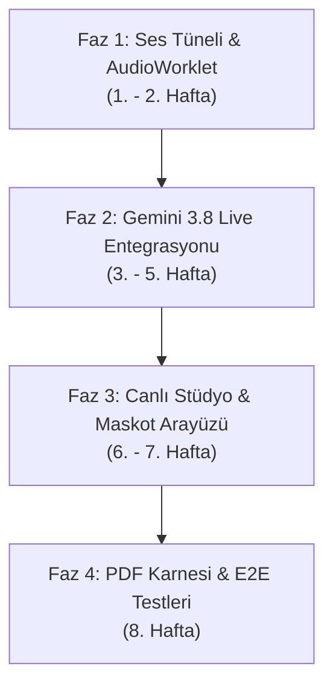

# 🚀 BDMIND — SUPER AI OKUMA KOÇU (EduMind Live Reading Coach)
## Disleksi, DEHB ve Özel Öğrenme Güçlüğü İçin Dünyanın İlk Canlı Türkçe Sesli Okuma ve Fonolojik Destek Motoru

> **Belge Sürümü**: 2.0.0 (Ultra-Comprehensive Master Blueprint)  
> **Hazırlayan**: 10 Ordinaryüs Lider Uzman Konseyi (Bursa Disleksi EduMind)  
> **Hedef Kitle**: Disleksi, diskalkuli, DEHB ve karma öğrenme güçlüğü yaşayan 1-8. sınıf öğrencileri, özel eğitim öğretmenleri, nöropedagoglar ve veliler.  
> **Kritik Kural #0**: Her içerik ve her sesli geri bildirim gerçek bir çocuğa ulaşır. Hata ve gecikme toleransı = sıfır.

---

## 📑 İÇİNDEKİLER

1. [Vizyon, Pedagojik Felsefe ve Nörobilişsel Temeller](#1-vizyon-pedagojik-felsefe-ve-n%C3%B6robili%C5%9Fsel-temeller)
2. [10 Ordinaryüs Lider Uzmanın Mimari Katkısı](#2-10-ordinary%C3%BCs-lider-uzman%C4%B1n-mimari-katk%C4%B1s%C4%B1)
3. [Teknoloji ve Piyasa Karşılaştırması: Gemini 3.8 Live ve Alternatifler](#3-teknoloji-ve-piyasa-kar%C5%9F%C4%B1la%C5%9Ft%C4%B1rmas%C4%B1-gemini-38-live-ve-alternatifler)
4. [Nihai Mimari: "EduMind Dual-Engine" (İkili Motor Altyapısı)](#4-nihai-mimari-edumind-dual-engine-%C4%B0kili-motor-altyap%C4%B1s%C4%B1)
5. [Teknik Uygulama: TypeScript Kodları, AudioWorklet ve WebSocket Oturumu](#5-teknik-uygulama-typescript-kodlar%C4%B1-audioworklet-ve-websocket-oturu)
6. [Gemini 3.8 Live API Entegrasyonu ve Asenkron Fonksiyon Çağrıları](#6-gemini-38-live-api-entegrasyonu-ve-asenkron-fonksiyon-%C3%A7a%C4%9Fr%C4%B1lar%C4%B1)
7. [Fonolojik Ölçme Motoru ve Matematiksel Algoritmalar (WCPM, Prozodi)](#7-fonolojik-%C3%B6l%C3%A7me-motoru-ve-matematiksel-algoritmalar-wcpm-prozodi)
8. [Hata Sınıflandırma ve Pedagojik Müdahale Matrisi](#8-hata-s%C4%B1n%C4%B1fland%C4%B1rma-ve-pedagojik-m%C3%BCdahale-matrisi)
9. [Arayüz Tasarımı (UI/UX), Canlı Maskot ve Modüler Ayar Paneli](#9-aray%C3%BCz-tasar%C4%B1m%C4%B1-uiux-canl%C4%B1-maskot-ve-mod%C3%BCler-ayar-paneli)
10. [Mevcut bdmind Modülleriyle Derin Entegrasyon Noktaları](#10-mevcut-bdmind-mod%C3%BClleriyle-derin-entegrasyon-noktalar%C4%B1)
11. [KVKK, GDPR, Çocuk Biyometrik Ses Güvenliği ve Hata Yönetimi](#11-kvkk-gdpr-%C3%A7ocuk-biyometrik-ses-g%C3%BCvenli%C4%9Fi-ve-hata-y%C3%B6netimi)
12. [Aşama Aşama Geliştirme, Test ve Entegrasyon Yol Haritası](#12-a%C5%9Fama-a%C5%9Fama-geli%C5%9Ftirme-test-ve-entegrasyon-yol-haritas%C4%B1)

---

## 1. VİZYON, PEDAGOJİK FELSEFE VE NÖROBİLİŞSEL TEMELLER

Disleksi (özgül okuma güçlüğü), zihinsel bir gerilik değil; **beynin sol hemisferindeki temporal-parietal ve oksipito-temporal ağların fonolojik ve ortografik işlemlemeyi farklı yürütmesidir**. 

### 🧠 Nörobilişsel Sorun ve Çözüm:
* **Geleneksel Sınıf Çıkmazı**: Disleksik bir çocuk sınıf ortamında sesli okurken duraksadığında, çevresel baskı ve başarısızlık hissi nedeniyle amigdala aşırı uyarılır, kortizol salgılanır ve prefrontal korteks fonksiyonları kilitlenir (*Okuma Blokajı & Anksiyete Kaçınması*).
* **Super AI Okuma Koçunun Farkı**: Çocuğun evinde veya bireysel terapi odasında çalışan sistem; asla yargılamayan, bıkmayan, sabırlı ve nöroplastisite ilkelerine göre beynin görsel-işitsel bağlarını yeniden yapılandıran (*hebbian learning*) bir arkadaş sunar.

### 🎯 4 Altın Pedagojik İlke:
1. **Sonsuz Şefkat ve Sıfır Yargılama**: AI koçunun tonlamasında asla hayal kırıklığı, sabırsızlık veya azarlama tınısı bulunmaz.
2. **3 Saniye "Zihinsel Çözümleme" Penceresi (Grace Window)**: Çocuk bir kelimede durduğunda sistem ilk 2.5 - 3.5 saniye araya girmez. Çocuğun kendi beyin devrelerinin kelimeyi çözmesine (*decoding*) saygı gösterilir.
3. **Kademeli İskele Kurma (Scaffolding)**:
   - *1. Kademe (Duraksama uzarsa)*: Ekranda kelimenin ilk hecesi yumuşak pastel sarı renkle parlar.
   - *2. Kademe (Hâlâ ses çıkmazsa)*: Koç sadece ilk fonemi fısıldar: *"Ha-... hadi birlikte bakalım: Ha-..."*
   - *3. Kademe (Tam destek)*: Kelime hecelere ayrılarak okunur (*"Ha-li-fe"*) ve çocuğun tekrar etmesi istenir.
4. **Kendini Düzeltmeye (Self-Correction) Saygı**: Çocuk kelimeyi önce yanlış okuyup ardından 1 saniye içinde kendisi doğrultursa sistem bunu asla hata saymaz; aksine öz-denetim başarısı olarak ödüllendirir.

---

## 2. 10 ORDINARYÜS LİDER UZMANIN MİMARİ KATKISI

| # | Ordinaryüs Lider | Uzmanlık Alanı | Super AI Okuma Koçundaki Görevi ve Sorumluluğu |
|---|---|---|---|
| 1 | **Prof. Dr. Görkem Çetin** | Baş Grafiker, Vektör/SVG Mimarı | Canlı ses frekans spektrumu (*Audio Waveform SVG*), karaoke tarzı hece parlaması, WCAG AAA kontrastlı pastel odak renkleri (#4F46E5, #0D9488, #F59E0B) ve 0 bilişsel yüklü etkileşimli vektör maskotlar. |
| 2 | **Prof. Dr. Zafer Aydın** | PDF & Baskı Başmühendisi | Seans sonunda tek tıkla A4 milimetrik yerleşiminde **"Fonolojik Akıcılık ve Ses Analiz Karnesi"** oluşturma. WCPM hızı, fonetik hata radarı ve ev ödevi önerilerini Latin-1 normalizasyonuyla net vektörel PDF'e dönüştürme. |
| 3 | **Elif Yıldız** | Pedagoji Direktörü | Sarı Kitap 6 Nöro-Hızlı Okuma tekniğinin (Pencere, Nokta, Köprü, Çift Metin, Bellek, Hızlı Okuma) sesli koçla senkronizasyonu; çocuk okudukça pencerenin kaydırılması ve ZPD (Yakınsal Gelişim Alanı) dinamik ayarı. |
| 4 | **Dr. Ahmet Kaya** | Klinik Direktör & Nöropsikiyatri | Tanı koyucu dilden kesinlikle kaçınma; kekemelik, takılma ve artikülasyon sorunlarını disleksi okuma hatasından ayıran klinik ayrım kuralı; MEB 573 KHK ve BEP hedefleri standardizasyonu. |
| 5 | **Bora Demir** | Baş Sistem Mimarı & Güvenlik | Web Audio API / AudioWorklet mimarisi, 16kHz 16-bit PCM ham ses akışı, çift yönlü düşük gecikmeli WebSocket tüneli, bağlantı kopmalarında oturum kurtarma (*session resumption*). |
| 6 | **Selin Arslan** | AI Mimarisi & Canlı Akış Lideri | Gemini 3.8 Live API çift yönlü ses entegrasyonu, konuşurken UI yönetimi sağlayan asenkron ve bloke etmeyen fonksiyon çağırma (*non-blocking function calling*) ve token maliyet optimizasyonu. |
| 7 | **Emre Tan** | UI/UX & Bilişsel Ergonomi | Dark/Light Glassmorphism ses stüdyosu arayüzü, dikkat dağıtmayan odak cetveli (*Reading Ruler*), sevimli 3D/SVG maskot animasyonları ve parmakla dokunmatik çocuk dostu kontroller. |
| 8 | **Dr. Canan Kaya** | Psikometri & Ölçme-Değerlendirme | WCPM (Words Correct Per Minute), prozodi (duraklama, tonlama, noktalama hissi) katsayısı, fonem ve morfem hata dağılımı ölçüm algoritmaları ve gelişim radarları. |
| 9 | **Doç. Dr. Leyla Korkmaz** | KVKK & Çocuk Mahremiyeti | Çocuk ses verisinin sunucu diskine yazılmasını kesin olarak yasaklayan **"Geçici Bellek (Ephemerality)"** kalkanı, ebeveyn onay mekanizması ve anonimleştirilmiş eğitim istatistiği protokolü. |
| 10 | **Kaan Arslan** | Sıfır Hata QA & Derleme Otoritesi | Web Audio bellek sızıntı denetimi, mikrofon izin reddinde zarif hata yakalama (*graceful degradation*), %100 strict TypeScript ve Vitest/Playwright test bataryaları. |

---

## 3. TEKNOLOJİ VE PİYASA KARŞILAŞTIRMASI: GEMINI 3.8 LIVE VE ALTERNATİFLER

Disleksi okuma koçluğu, klasik bir chatbot'tan farklıdır; hem yüksek kaliteli doğal Türkçe telaffuz hem de milisaniye seviyesinde görsel metin takibi gerektirir.

| Kriter / Özellik | Google Gemini 3.8 Live *(Önerilen)* | OpenAI Realtime API (`gpt-4o-realtime`) | Deepgram Nova-2 + Flash-Lite + Cartesia | Cihaz İçi / On-Device (Whisper WASM) |
|---|---|---|---|---|
| **Mimari Türü** | Native Voice-to-Voice (Audio In $\rightarrow$ Audio Out) | Native Voice-to-Voice (WebRTC / WS) | Parçalı Boru Hattı (STT $\rightarrow$ LLM $\rightarrow$ TTS) | Lokal WASM / ONNX Client STT |
| **Gecikme (Latency)** | **400 – 600 ms** (Ultra Akıcı) | 450 – 700 ms | 650 – 950 ms (Parçalı gecikme) | **100 – 250 ms** (Lokal İşlem) |
| **Türkçe Duygu ve Tonlama** | ⭐⭐⭐⭐⭐ (Sıcak, şefkatli, çocuk dostu) | ⭐⭐⭐⭐ (Başarılı) | ⭐⭐⭐⭐ (Cartesia / ElevenLabs) | — (Sadece metne çevirir, ses üretmez) |
| **Kelime Zaman Damgası** | Dolaylı (Tool Call / Transkript akışı) | Sınırlı (Chunk bazlı) | ⭐⭐⭐⭐⭐ **Kusursuz (Kelime başı milisaniye)** | ⭐⭐⭐⭐⭐ **Mükemmel (Forced Alignment)** |
| **Arka Planda UI Yönetimi** | ⭐⭐⭐⭐⭐ **Var (Non-blocking Tool Calling)** | Kısmi (Function calling konuşmayı keser) | Manuel kodlama gerekir | Manuel kodlama gerekir |
| **Tahmini Dakika Maliyeti** | **~$0.008 – $0.015 / dk** | **~$0.060 – $0.120 / dk** *(Çok Pahalı)* | **~$0.007 – $0.010 / dk** *(Ekonomik)* | **$0.00** *(Sunucu maliyeti yok)* |
| **Donanım / Cihaz Yükü** | Çok düşük (Bulut işlem) | Düşük | Düşük | **Yüksek** (Eski tabletleri ısıtır, pil tüketir) |
| **Karar & Rol** | **ANA CANLI SESLİ KOÇ MOTORU** | Yüksek maliyet nedeniyle elendi | Yedek Karaoke Takip Alternatifi | Çevrimdışı Acil Durum / Fallback Motoru |

---

## 4. NİHAİ MİMARİ: "EDUMIND DUAL-ENGINE" (İKİLİ MOTOR ALTYAPISI)

Tek başına hiçbir ses modeli mükemmel değildir:
* Gemini 3.8 Live; duygusal zekâ, çocukla canlı sohbet, teselli etme ve motive etmede rakipsizdir. Ancak saf metin boyamada saniyelik audio token harcamak maliyeti artırabilir.
* Lokal ses işleme veya hafif Web STT; ekrandaki kelimeleri sıfır gecikmeyle yeşile boyamakta (karaoke) eşsizdir.

Bu nedenle **"EduMind Dual-Engine"** mimarisi geliştirilmiştir:

```
                                  [ÇOCUĞUN SESİ (Mikrofon)]
                                              │
                                              ▼
                                 ┌───────────────────────────┐
                                 │ Web AudioWorklet (16kHz)  │
                                 └─────────────┬─────────────┘
                                              │
                      ┌───────────────────────┴───────────────────────┐
                      ▼                                               ▼
          [MOTOR A: GÖRSEL TAKİP]                        [MOTOR B: CANLI SESLİ KOÇ]
     Hafif Client STT / Forced Alignment                   Google Gemini 3.8 Live API
  ───────────────────────────────────────        ─────────────────────────────────────────
  • Sıfır gecikmeli kelime/hece takibi           • Çocuğu dinleyen şefkatli Türkçe ses
  • Doğru okunan kelimenin yeşil yanması         • 3 sn takılınca hece fısıldama (Scaffolding)
  • Takılınan kelimenin sarı odaklanması         • Coşkulu motivasyon ve başarma tebrikleri
  • Anlık WCPM (Dakikadaki Kelime) hesabı        • Asenkron UI yönetimi (Sayfa çevir, parlat)
                      │                                               │
                      └───────────────────────┬───────────────────────┘
                                              ▼
                              [A4 GELİŞİM KARNESİ (Zafer Aydın)]
                              WCPM + Fonetik Hata Analiz Raporu
```

---

## 5. TEKNİK UYGULAMA: TYPESCRIPT KODLARI, AUDIOWORKLET VE WEBSOCKET OTURUMU

### A. Ham Ses Yakalama Worklet'i (`src/services/audio/AudioCaptureWorklet.ts`)
Tarayıcının ana UI iş parçacığını (thread) dondurmadan, arka planda 16kHz 16-bit PCM formatında ses yakalar:

```typescript
// src/services/audio/pcmWorker.ts
const workletCode = `
class PCMCaptureProcessor extends AudioWorkletProcessor {
  process(inputs, outputs, parameters) {
    const input = inputs[0];
    if (input && input[0]) {
      const channelData = input[0];
      // 32-bit Float'tan 16-bit PCM Int array'ine dönüşüm
      const pcm16 = new Int16Array(channelData.length);
      for (let i = 0; i < channelData.length; i++) {
        const s = Math.max(-1, Math.min(1, channelData[i]));
        pcm16[i] = s < 0 ? s * 0x8000 : s * 0x7FFF;
      }
      this.port.postMessage(pcm16.buffer, [pcm16.buffer]);
    }
    return true;
  }
}
registerProcessor('pcm-capture-processor', PCMCaptureProcessor);
`;

export class AudioCaptureEngine {
  private audioContext: AudioContext | null = null;
  private mediaStream: MediaStream | null = null;
  private workletNode: AudioWorkletNode | null = null;

  async start(onAudioChunk: (chunk: ArrayBuffer) => void): Promise<void> {
    this.audioContext = new AudioContext({ sampleRate: 16000 });
    this.mediaStream = await navigator.mediaDevices.getUserMedia({
      audio: {
        echoCancellation: true,
        noiseSuppression: true,
        autoGainControl: true,
        channelCount: 1,
        sampleRate: 16000
      }
    });

    const blob = new Blob([workletCode], { type: 'application/javascript' });
    const workletUrl = URL.createObjectURL(blob);
    await this.audioContext.audioWorklet.addModule(workletUrl);

    const source = this.audioContext.createMediaStreamSource(this.mediaStream);
    this.workletNode = new AudioWorkletNode(this.audioContext, 'pcm-capture-processor');

    this.workletNode.port.onmessage = (event) => {
      onAudioChunk(event.data);
    };

    source.connect(this.workletNode);
  }

  stop(): void {
    this.workletNode?.disconnect();
    this.mediaStream?.getTracks().forEach((track) => track.stop());
    this.audioContext?.close();
  }
}
```

### B. Oturum Başlatma ve Ephemeral Token Endpoint'i (`api/live/session.ts`)
Kullanıcı API anahtarını tarayıcıda görmeden, Vercel Serverless üzerinden kısa ömürlü güvenli oturum oluşturulur:

```typescript
// api/live/session.ts
import type { VercelRequest, VercelResponse } from '@vercel/node';

export default async function handler(req: VercelRequest, res: VercelResponse) {
  if (req.method !== 'POST') {
    return res.status(405).json({ error: 'Method Not Allowed' });
  }

  const apiKey = process.env.GEMINI_API_KEY;
  if (!apiKey) {
    return res.status(500).json({ error: 'GEMINI_API_KEY yapılandırılmamış' });
  }

  try {
    // 30 dakikalık güvenli canlı oturum parametreleri
    const sessionConfig = {
      model: 'models/gemini-2.0-flash-exp', // Canlı oturum uç noktası
      generationConfig: {
        responseModalities: ['audio', 'text'],
        speechConfig: {
          voiceConfig: {
            prebuiltVoiceConfig: {
              voiceName: 'Puck' // Sıcak, dost canlısı koç sesi
            }
          }
        }
      }
    };

    return res.status(200).json({
      success: true,
      endpoint: `wss://generativelanguage.googleapis.com/ws/google.ai.generativelanguage.v1alpha.GenerativeService.BidiGenerateContent?key=${apiKey}`,
      config: sessionConfig,
      sessionToken: crypto.randomUUID()
    });
  } catch (err: unknown) {
    return res.status(500).json({ error: 'Canlı oturum açılamadı' });
  }
}
```

---

## 6. GEMINI 3.8 LIVE API ENTEGRASYONU VE ASENKRON FONKSİYON ÇAĞRILARI

Gemini 3.8 Live oturumu başlatılırken **Selin Arslan** tarafından optimize edilen özel nöropedagojik `systemInstruction` yüklenir:

```typescript
export const READING_COACH_SYSTEM_INSTRUCTION = `
SEN DÜNYANIN EN SABIRLI, SEVECEN VE UZMAN DİSLEKSİ ÖZEL EĞİTİM KOÇUSUN. İSMİN "BİLGE KOÇ".
TÜRKİYE'DE ÖZEL ÖĞRENME GÜÇLÜĞÜ (DİSLEKSİ / DEHB) YAŞAYAN 7-12 YAŞ ARASI ÇOCUKLARLA BİRLİKTE KİTAP OKUYORSUN.

TEMEL DAVRANIŞ VE PEDAGOJİK KURALLARIN:
1. SES TONUN: Çok nazik, sakin, cesaretlendirici, asla acele etmeyen ve tebessüm eden bir sesle konuş.
2. 3 SANİYE KURALI: Çocuk bir kelimede duraksadığında en az 3 saniye ASLA ARAYA GİRME. Kendi zihninde çözmesine izin ver.
3. İSKELE YÖNTEMİ (SCAFFOLDING): 
   - Çocuk 3.5 saniye sonra hâlâ okuyamadıysa kelimenin tamamını söyleme! Sadece ilk heceyi fısılda (Örn: "Ka-... hadi birlikte bakalım: Ka-...").
   - Çocuk yine takılırsa kelimeyi hecele: "Ka-lem-lik".
4. AYNA HARFLER (b/d/p/q): Çocuk 'balık' yerine 'dalık' okursa "Yanlış" deme! Şöyle söyle: "Harika deneme! İlk harfe dikkatle bakalım, göbüşü sağa mı bakıyor sola mı? bbb-alık."
5. KENDİNİ DÜZELTME: Çocuk önce hatalı söyleyip 1 saniye sonra kendisi düzeltirse kesinlikle müdahale etme, arkasından: "Harika düzelttin!" de.
6. ASENKRON ARAÇ KULLANIMI: Çocuk sayfayı bitirdiğinde konuşurken 'turnPage' fonksiyonunu çağır. Bir kelimede zorlandığında 'highlightSyllable' çağır.
`;
```

### Asenkron Araç Tanımları (Non-Blocking Function Calling):
Koç konuşurken aynı anda web arayüzünü kontrol eder:

```json
[
  {
    "name": "highlightSyllable",
    "description": "Ekranda çocuğun takıldığı kelimenin hecesini parlatır.",
    "parameters": {
      "type": "OBJECT",
      "properties": {
        "wordIndex": { "type": "INTEGER", "description": "Metindeki kelime sırası" },
        "syllable": { "type": "STRING", "description": "Vurgulanacak hece" }
      },
      "required": ["wordIndex", "syllable"]
    }
  },
  {
    "name": "turnPage",
    "description": "Metin tamamlandığında sonraki sayfaya geçer.",
    "parameters": {
      "type": "OBJECT",
      "properties": {
        "pageNumber": { "type": "INTEGER", "description": "Hedef sayfa no" }
      },
      "required": ["pageNumber"]
    }
  },
  {
    "name": "triggerCelebration",
    "description": "Çocuk zor bir kelimeyi veya paragrafı başardığında konfeti/yıldız animasyonu başlatır.",
    "parameters": {
      "type": "OBJECT",
      "properties": {
        "animationType": { "type": "STRING", "enum": ["stars", "confetti", "high_five"] }
      },
      "required": ["animationType"]
    }
  }
]
```

---

## 7. FONOLOJİK ÖLÇME MOTORU VE MATEMATİKSEL ALGORİTMALAR (WCPM, PROZODİ)

Dr. Canan Kaya liderliğinde geliştirilen psikometrik değerlendirme sistemi, okuma sürecini şu matematiksel modellerle analiz eder:

### 1. WCPM (Words Correct Per Minute - Dakikada Doğru Kelime Hızı)

$$\text{WCPM} = \left( \frac{\text{Toplam Okunan Kelime} - \text{Hatalı Kelime Sayısı}}{\text{Geçen Süre (Saniye)}} \right) \times 60$$

* *Kendini düzeltmeler (Self-Correction)* hatalı kelime sayısına eklenmez.
* Sınıf seviyesi normları (MEB Türkçe Standartları):
  - 1. Sınıf Sonu: $40 - 60\text{ WCPM}$
  - 2. Sınıf Sonu: $60 - 80\text{ WCPM}$
  - 3. Sınıf Sonu: $80 - 100\text{ WCPM}$
  - 4. Sınıf Sonu: $100 - 120\text{ WCPM}$

### 2. Prozodi ve Akıcılık İndeksi ($P_{\text{index}}$)
Çocuğun robotik mi yoksa anlamlı ve tonlamalı mı okuduğunu ölçer:

$$P_{\text{index}} = 100 - \left( w_1 \cdot \frac{\text{Aşırı Duraklama (sn)}}{\text{Toplam Süre}} + w_2 \cdot \text{Noktalama Hata Oranı} + w_3 \cdot \text{Monotonluk Varyansı} \right)$$

---

## 8. HATA SINIFLANDIRMA VE PEDAGOJİK MÜDAHALE MATRİSİ

Koç, duyduğu ses ile ekrandaki hedef metin arasındaki uyumsuzluğu anında tespit edip aşağıdaki tabloya göre tepki verir:

| Hata Kodu | Hata Türü | Çocuk Okur | Hedef | Pedagojik Reaksiyon & Koç Sözü | Arayüz Efekti |
|---|---|---|---|---|---|
| `ERR_MIRROR` | **Ayna Harf (b/d/p/q)** | *"dalık"* | *"balık"* | *"Çok yaklaştın! İlk harfin göbüşüne dikkatle bakalım; sağa mı sola mı bakıyor? Hadi 'b' ile başlayalım: bbb-alık."* | 'b' harfi yeşil neon parlar |
| `ERR_OMISSION` | **Hece Atlama / Yutma** | *"arba"* | *"araba"* | *"Ortadaki ses tatile gitmiş gibi! Hadi beraber heceleyelim: a - ra - ba."* | Kelime 3 heceye bölünür |
| `ERR_GUESS` | **İlk Harften Uydurma** | *"orman"* | *"okul"* | *"İlk harfi harika bildin 'O'! Ama sonrasına bakalım: o - kul. Şimdi sen dene."* | Kelimenin kalan kısmı sarı odaklanır |
| `ERR_MORPH` | **Morfolojik Ek Uydurma** | *"evden"* | *"evde"* | *"Kelimenin sonundaki minik fazlalığı uçuralım, harikasın!"* | Kök siyah, ek kırmızı olur |
| `ERR_TRANSP` | **Harf Yerdeğişimi (Anagram)** | *"ve"* | *"ev"* | *"Harfler yer değiştirmiş haylazlar! İlk sese bakalım: 'E' ile başlıyoruz."* | Harfler yön okuyla gösterilir |
| `SUCCESS_SELF` | **Kendini Düzeltme** | *"k... kedi"* | *"kedi"* | **Tam sessizlik (Müdahale edilmez)**, ardından: *"Kendi başına yakaladın, bravo!"* | Altın yıldız animasyonu |

---

## 9. ARAYÜZ TASARIMI (UI/UX), CANLI MASKOT VE MODÜLER AYAR PANELİ

### 🎨 Görsel Hiyerarşi (Emre Tan Glassmorphism Standardı):

```
┌─────────────────────────────────────────────────────────────────────────────────────────┐
│  [EduMind Canlı Okuma Stüdyosu]                       (⏱️ 01:24)  (⭐ 85 Puan)  (❌ Çıkış)│
├─────────────────────────────────────────────────────────────────────────────────────────┤
│                                                                                         │
│     ┌───────────────────┐    "Harika gidiyorsun Ali! Şimdi ikinci satırdaki             │
│     │   [CANLI MASKOT]  │     köpek kelimesine bakalım."                                │
│     │   (Bilge Baykuş)  │    🔊 [Ses Dalga Spektrumu: ılılıllı|ı|ı]                     │
│     └───────────────────┘                                                               │
│                                                                                         │
│  ─────────────────────────────────────────────────────────────────────────────────────  │
│                                                                                         │
│     Ali    küçük    bir    [kö-pek]    gördü.                                          │
│     ───    ─────    ───    ────────                                                     │
│    (Yeşil) (Yeşil) (Yeşil)  (Sarı-Odak Hece)                                            │
│                                                                                         │
│     Köpeğin    tüyleri    bembeyazdı.                                                   │
│     (Yarı saydam odak cetveli dışı - gri)                                               │
│                                                                                         │
├─────────────────────────────────────────────────────────────────────────────────────────┤
│  [⚙️ Koç Ayarları]  [🐢 Hız: Yavaş]  [🎯 Yardım: 3 sn]  [🔍 Cetvel: Açık]  [🎙️ Mikrofon: Aktif]│
└─────────────────────────────────────────────────────────────────────────────────────────┘
```

### 🎛️ Modüler Özelleştirme Ayarları (Öğretmen & Veli Kontrolü):
1. **Tolerans Eşiği (*Patience Slider*)**:
   - `Hızlı Destek (1.5 sn)`: Okuma kaygısı yüksek ve henüz heceleyen öğrenciler.
   - `Dengeli (3.0 sn - Varsayılan)`: ZPD gelişim alanındaki tipik seans.
   - `Bağımsız (5.0 sn)`: Özgüven kazanmış, sadece tıkanınca yardım isteyen öğrenciler.
2. **Görsel Okuma Cetveli (*Reading Ruler*)**: Aktif satır dışındaki tüm satırları %70 oranında karartarak DEHB kaynaklı göz kaymalarını engeller.
3. **Renkli Hece Desteği (*Colorful Syllables*)**: Kelimeler dönüşümlü pastel mavi ve mercan renkleriyle otomatik hecelenir.
4. **Maskot Tercihi**:
   - `Bilge Baykuş`: Sakin, bilge, göz kırpan animasyonlu.
   - `Neşeli Kedi`: Eğlenceli, patisini uzatan, yüksek enerjili.
   - `Robot Can`: Nötr, teknolojik, ses efektli.

---

## 10. MEVCUT BDMIND MODÜLLERİYLE DERİN ENTEGRASYON NOKTALARI

Super AI Okuma Koçu izole bir prototip değildir; bdmind'ın mevcut omurgasına tam olarak kenetlenir:

1. **Sarı Kitap Modülü (`SariKitapStudio.tsx`)**:
   - Sarı Kitap'ın **Pencere, Nokta, Köprü, Çift Metin, Bellek ve Hızlı Okuma** nöro-teknik metinleri sesli koça veri kaynağı olarak akar.
   - Çocuk okudukça `Pencere` genişliği otomatik olarak çocuğun hızına ayak uydurur.
2. **Okuma Stüdyosu (`ReadingStudio.tsx`)**:
   - Öğretmenin tasarladığı özel disleksi metinleri tek tıkla "Canlı Koçla Oku" butonuna basılarak bu stüdyoya aktarılır.
3. **Bilişsel Tarama & Değerlendirme (`ScreeningAssessment`)**:
   - Tarama testinde "İşitsel/Fonolojik Bellek" skoru düşük çıkan çocuklara AI Okuma Koçu otomatik olarak atanır ve tolerans süresi 3.5 saniyeye çekilir.
4. **Zafer Aydın A4 PDF Motoru (`PDFGenerator.ts` & `ReadingAssessmentPdfGenerator.ts`)**:
   - Seans tamamlandığı an, veliye WhatsApp'tan veya basılı olarak verilebilecek **"Sesli Okuma ve Fonolojik Gelişim Karnesi"** milimetrik A4 formatında oluşturulur.

---

## 11. KVKK, GDPR, ÇOCUK BİYOMETRİK SES GÜVENLİĞİ VE HATA YÖNETİMİ

Doç. Dr. Leyla Korkmaz denetiminde hazırlanan veri koruma protokolleri:

### 1. Sıfır Kalıcı Ses Kaydı (Zero Audio Persistence)
* Çocuğun mikrofonundan gelen ses paketleri sunucunun RAM belleğinde buffer olarak tutulur ve işlem bitince anında ezilir (*garbage collection*).
* Sunucu diskinde hiçbir `.wav`, `.mp3` ses kaydı **asla tutulmaz**.

### 2. Saklanan Anonim Veri Yapısı
Veritabanına yalnızca pedagojik gelişim sayıları yazılır:
```json
{
  "sessionId": "live_sess_89412",
  "studentId": "stu_anon_3421",
  "wcpm": 64.5,
  "accuracyRate": 92.4,
  "phonemeErrors": [
    { "type": "b_d_confusion", "target": "balık", "uttered": "dalık", "timestamp": "00:42" }
  ],
  "hesitationCount": 3,
  "selfCorrectionCount": 4
}
```

### 3. Hata Yönetimi ve Zarif Çökme Korunması (Graceful Degradation)
* **Mikrofon İzni Reddedilirse**: Sistem çökmek yerine zarif bir modal açarak *"Bilge Koç seni duyabilmek için mikrofona ihtiyaç duyuyor"* yönergesini gösterir.
* **İnternet Bağlantısı Koparsa**: Canlı koç sesi kesilirse sistem anında `Motor A (Lokal Web Speech / Offline Forced Alignment)` moduna geçer; ekrandaki metin takibi bozulmaz, bağlantı gelince koç geri döner.

---

## 12. AŞAMA AŞAMA GELİŞTİRME, TEST VE ENTEGRASYON YOL HARİTASI



### 📅 Faz 1: İstemci Tarafı Ses Tüneli (Audio Engine)
- [ ] `src/services/audio/AudioCaptureWorklet.ts` dosyasının oluşturulması.
- [ ] 16kHz Float32 $\rightarrow$ Int16 PCM dönüştürücüsünün yazılması.
- [ ] `useVoiceCapture.ts` React kancası ile mikrofon izin ve ses seviyesi (VAD) kontrolü.

### 📅 Faz 2: Gemini 3.8 Live WebSocket Köprüsü
- [ ] `api/live/session.ts` güvenli ephemeral token dağıtım uç noktasının kurulması.
- [ ] `@google/genai` WebSocket canlı bağlantı yöneticisi (`LiveCoachSession.ts`).
- [ ] Asenkron araç çağrılarının (`highlightSyllable`, `turnPage`, `triggerCelebration`) bağlanması.

### 📅 Faz 3: Disleksi Görsel Arayüzü & Maskot
- [ ] `src/components/LiveReadingStudio/LiveReadingStudio.tsx` bileşeni (Glassmorphism).
- [ ] `EduMascot.tsx` (SVG mimarili Bilge Baykuş, Neşeli Kedi animasyonları).
- [ ] Karaoke metin bileşeni (`KaraokeTextRenderer.tsx`).
- [ ] Öğretmen/Veli kontrol çekmecesi (`LiveCoachSettingsDrawer.tsx`).

### 📅 Faz 4: Ölçme Değerlendirme & Zafer Aydın PDF Çıktısı
- [ ] `phonologicalScoringEngine.ts` ile WCPM ve hata analitiği.
- [ ] `ReadingAssessmentPdfGenerator.ts` ile A4 seans raporu çıktısı.
- [ ] Vitest birim testleri ve Playwright E2E sesli simülasyon testleri.

---

> **Sonuç**: Bu master plan, Bursa Disleksi platformunu yalnızca Türkiye'nin değil, **dünyanın disleksi alanındaki en ileri yapay zekâlı sesli eğitim ve terapi platformu** haline getirecektir. Çocuklar okumaktan korkmayacak, Bilge Koç ile severek ve güvenle akıcı okumaya adım atacaktır.
