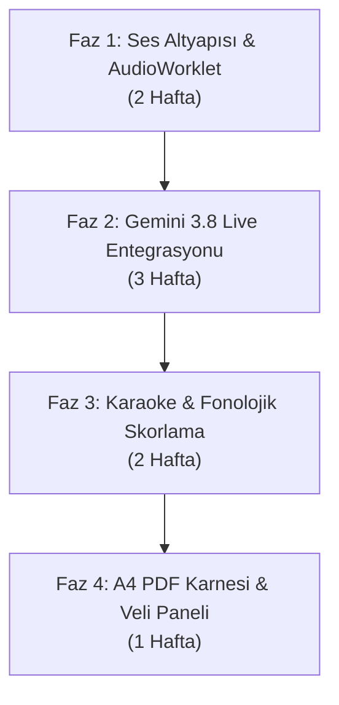

# 🚀 BDMIND — AI OKUMA KOÇU (EduMind Live Reading Coach)
## Disleksi, DEHB ve Özel Öğrenme Güçlüğü İçin Dünyanın İlk Canlı Türkçe Sesli Okuma ve Fonolojik Destek Motoru

> **Belge Sürümü**: 1.0.0 (Master Blueprint)  
> **Hazırlayan**: 10 Ordinaryüs Lider Uzman Konseyi (Bursa Disleksi EduMind)  
> **Hedef**: Disleksik çocuğun okuma eylemini kulaktan dinleyen, anlık hece/kelime takibi yapan, telaffuz hatalarını kırmadan düzelten, sıfır gecikmeli, ultra-akıcı yapay zekâ okuma arkadaşı.

---

## 📑 İÇİNDEKİLER

1. [Vizyon, Pedagojik Felsefe ve Nörobilişsel Temeller](#1-vizyon-pedagojik-felsefe-ve-n%C3%B6robili%C5%9Fsel-temeller)
2. [10 Ordinaryüs Lider Uzmanın Mimari Katkısı](#2-10-ordinary%C3%BCs-lider-uzman%C4%B1n-mimari-katk%C4%B1s%C4%B1)
3. [Teknoloji Karşılaştırması: Gemini 3.8 Live ve Piyasa Alternatifleri](#3-teknoloji-kar%C5%9F%C4%B1la%C5%9Ft%C4%B1rmas%C4%B1-gemini-38-live-ve-piyasa-alternatifleri)
4. [Tavsiye Edilen Nihai Mimari: "EduMind Dual-Engine" (İkili Motor)](#4-tavsiye-edilen-nihai-mimari-edumind-dual-engine-%C4%B0kili-motor)
5. [Arayüz (UI/UX), Maskot ve Modüler Ayar Paneli](#5-aray%C3%BCz-uiux-maskot-ve-mod%C3%BCler-ayar-paneli)
6. [Hata Sınıflandırma ve Pedagojik Müdahale Matrisi](#6-hata-s%C4%B1n%C4%B1fland%C4%B1rma-ve-pedagojik-m%C3%BCdahale-matrisi)
7. [KVKK, Biyometrik Çocuk Ses Verisi ve Etik Standartlar](#7-kvkk-biyometrik-%C3%A7ocuk-ses-verisi-ve-etik-standartlar)
8. [Aşama Aşama Geliştirme ve Entegrasyon Yol Haritası](#8-a%C5%9Fama-a%C5%9Fama-geli%C5%9Ftirme-ve-entegrasyon-yol-haritas%C4%B1)

---

## 1. VİZYON, PEDAGOJİK FELSEFE VE NÖROBİLİŞSEL TEMELLER

Disleksi (özgül okuma güçlüğü), zekâ geriliği değil; **beynin sol temporal-parietal bölgesindeki fonolojik işlemleme mekanizmasının farklı çalışmasıdır**. 

Geleneksel eğitimde disleksik bir çocuk sesli okurken:
* Bir kelimede takıldığında sınıfın veya öğretmenin sabırsız bakışları altında **aşırı kortizol (stres hormonu) salgılar**.
* Prefrontal korteks bloke olur, çocuk okumayı bırakır (*okuma anksiyetesi ve kaçınma davranışı*).
* Harf atlar (*araba $\rightarrow$ aba*), harf karıştırır (*b $\leftrightarrow$ d, p $\leftrightarrow$ q*), ters okur (*ev $\rightarrow$ ve*), uydurarak tamamlar (*çanta $\rightarrow$ çadır*).

### 🎯 AI Okuma Koçunun Temel İlkeleri:
1. **Asla Yargılamayan Sonsuz Sabır**: Yapay zekâ koçu asla bıkmaz, ses tonunda en ufak bir sabırsızlık veya hayal kırıklığı tınısı barındırmaz.
2. **3 Saniye "Nefes ve Çözümleme" Prensibi (Grace Window)**: Çocuk bir kelimede duraksadığında sistem anında araya girip çocuğu bölmez. En az **2.5 - 3.5 saniye** çocuğun kendi zihinsel çözümleme (*decoding*) sürecine izin verir.
3. **Aşamalı İskele Kurma (Scaffolding)**: 
   - *1. Seviye Duraksama*: Bekle ve ekranda heceyi hafifçe parlat.
   - *2. Seviye (Çocuk hâlâ okuyamadı)*: Kelimenin tamamını söyleme! Sadece ilk heceyi fısılda: *"Ha-... hadi birlikte bakalım: Ha-..."*
   - *3. Seviye*: Kelimeyi heceleyerek oku (*"Ha-li-fe"*) ve çocuğun tekrar etmesini iste.
4. **Anında Pozitif Pekiştirme**: Her doğru telaffuz edilen zor kelimeden sonra mikro-övgüler (*"Harika bir birleştirme!", "Çok iyi yakaladın!"*).

---

## 2. 10 ORDINARYÜS LİDER UZMANIN MİMARİ KATKISI

Bu modül, platformumuzun 10 Ordinaryüs Liderinin ortak vizyonuyla kurgulanmıştır:

| # | Lider Uzman | Sorumluluk Alanı | AI Okuma Koçundaki Kritik Görevi |
|---|---|---|---|
| 1 | **Prof. Dr. Görkem Çetin** | Baş Grafiker & Vektör Mimarı | Canlı ses spektrum dalgası (*dynamic audio waveform*), karaoke tarzı hece parlaması, disleksi dostu yüksek kontrastlı renk vurguları (#4F46E5, #0D9488) ve 0 bilişsel yüklü SVG avatarlar. |
| 2 | **Prof. Dr. Zafer Aydın** | PDF & Baskı Başmühendisi | Seans bittiğinde tek tıkla A4 formatında **"Fonolojik Akıcılık ve Ses Analiz Karnesi"** çıktısı. Hata dağılım grafikleri, WCPM oranı ve ev ödevi yönergelerini milimetrik PDF'e dökme. |
| 3 | **Elif Yıldız** | Pedagoji Direktörü | Sarı Kitap 6 Hızlı Okuma motoru (Pencere, Nokta, Köprü, Çift Metin, Bellek) ile sesin senkronizasyonu; çocuk okudukça pencerenin kayması ve ZPD seviye kalibrasyonu. |
| 4 | **Dr. Ahmet Kaya** | Klinik Direktör & Nöropsikiyatri | Tanı koyucu dilden uzak durma; kekemelik, takılma ve artikülasyon bozukluklarını disleksi hatasından ayırt eden klinik sınır mantığı; MEB BEP hedefleri uyumu. |
| 5 | **Bora Demir** | Baş Sistem Mimarı & Güvenlik | WebRTC & AudioWorklet mimarisi, 16kHz PCM ham ses akışı, düşük gecikmeli WebSocket tüneli, bağlantı kopmalarında oturum kurtarma (*session resumption*). |
| 6 | **Selin Arslan** | AI Mimarisi & Canlı Akış Lideri | Gemini 3.8 Live API entegrasyonu, asenkron ve bloke etmeyen fonksiyon çağırma (*non-blocking function calling*) ile ses konuşurken UI'ın eş zamanlı yönetimi. |
| 7 | **Emre Tan** | UI/UX & Bilişsel Ergonomi | Sevimli, disleksi dostu maskot etkileşimi (EduKedi / Bilge Baykuş); çocuğun dikkatini dağıtmayacak Dark/Light Glassmorphism ses stüdyosu arayüzü. |
| 8 | **Dr. Canan Kaya** | Psikometri & Ölçme-Değerlendirme | WCPM (Words Correct Per Minute - Dakikada Doğru Okunan Kelime), Prozodi (tonlama/vurgu), duraklama süresi ve fonem hata oranlarının istatistiki ölçümü. |
| 9 | **Doç. Dr. Leyla Korkmaz** | KVKK & Çocuk Mahremiyeti | Çocuk ses verisinin sunucularda kalıcı kaydedilmesini engelleyen **"Geçici Ses İşleme (Ephemerality)"** protokolü, ebeveyn onay mekanizması. |
| 10 | **Kaan Arslan** | Sıfır Hata & Kalite Güvence QA | Web Audio API bellek sızıntısı denetimi, mikrofon izin reddi durumlarında zarif çökme koruması, %100 strict TypeScript güvenliği. |

---

## 3. TEKNOLOJİ KARŞILAŞTIRMASI: GEMINI 3.8 LIVE VE PİYASA ALTERNATİFLERİ

Piyasadaki en güncel canlı ses teknolojileri, disleksi okuma koçluğu gereksinimleri açısından incelenmiştir:

| Model / Teknoloji | Mimari Türü | Uçtan Uca Gecikme (*Latency*) | Türkçe Kalitesi & Telaffuz | Kelime Seviyesinde Zaman Damgası (*Word Timestamps*) | Tahmini Dakika Maliyeti | Güçlü Yönleri | Zayıf / Riskli Yönleri |
|---|---|---|---|---|---|---|---|
| **Google Gemini 3.8 Live** *(Önerilen Çekirdek)* | **Uçtan Uca Native Voice-to-Voice** (Audio in $\rightarrow$ Audio out) | **400 – 600 ms** (Ultra Akıcı) | ⭐⭐⭐⭐⭐ Doğal, empatik Türkçe ses, tonlama kontrolü | Dolaylı (Function call veya Transcribe Live eşliğiyle) | **~$0.008 – $0.015 / dk** | Konuşurken UI'ı yönetebilir (non-blocking tool calls), tek bir WebSocket bağlantısı, duygusal zekâsı yüksek. | Saf transkripsiyon için tek başına kelime milisaniyesi vermez (ek transkripsiyon katmanı ister). |
| **OpenAI Realtime API** (`gpt-4o-realtime`) | **Native Voice-to-Voice** (WebRTC / WS) | **450 – 700 ms** | ⭐⭐⭐⭐ İyi Türkçe | Sınırlı (Transcript chunking) | **~$0.06 – $0.12 / dk** *(Çok Pahalı)* | WebRTC desteği hazır, kesintileri (*barge-in*) çok iyi yakalar. | Gemini'ye göre **6-10 kat daha pahalı**; uzun seanslarda bütçeyi zorlar. |
| **Deepgram Nova-2 + Flash-Lite + Cartesia Sonic** | **Modüler Boru Hattı** (STT $\rightarrow$ LLM $\rightarrow$ TTS) | **650 – 950 ms** | ⭐⭐⭐⭐ (Cartesia/ElevenLabs Türkçe) | ⭐⭐⭐⭐⭐ **Kusursuz (Milisaniyelik kelime zamanlaması)** | **~$0.006 – $0.010 / dk** *(En Ucuz)* | Deepgram kelime kelime zaman damgası verir, karaoke için mükemmeldir. Çok ucuzdur. | 3 ayrı servis birbirine bağlıdır; biri aksarsa gecikme 1 saniyeyi aşar; doğal konuşma hissi Native Voice kadar sıcak değildir. |
| **Tarayıcı İçi / On-Device (Whisper WebAssembly / sherpa-onnx)** | **Yerel Cihaz İçi Hibrit** (Client-side WASM) | **150 – 300 ms** (Lokal STT) | ⭐⭐⭐ (Cihaza bağlı model) | ⭐⭐⭐⭐⭐ **Mükemmel (Forced Alignment)** | **$0.00 (Sıfır Sunucu Maliyeti)** | %100 KVKK uyumu (ses internete hiç çıkmaz), internetsiz çalışabilir. | Düşük donanımlı eski tablet ve telefonlarda cihazı ısıtır, pil tüketir; çocuk konuşmasını anlama hassasiyeti bulut kadar yüksek değildir. |

---

## 4. TAVSİYE EDİLEN NİHAİ MİMARİ: "EDUMIND DUAL-ENGINE" (İKİLİ MOTOR)

Dünyadaki en başarılı okuma asistanları saf bir chatbot veya saf bir ses tanıma motoru değildir. En yüksek kullanıcı deneyimi için **"İkili Motor (Dual-Engine)"** mimarisi uygulanmalıdır:

```
                                  [ÇOCUĞUN SESİ (Mikrofon)]
                                             │
                                             ▼
                               ┌───────────────────────────┐
                               │  Web Audio Worklet (PCM)  │
                               └─────────────┬─────────────┘
                                             │
                     ┌───────────────────────┴───────────────────────┐
                     ▼                                               ▼
         [MOTOR A: GÖRSEL TAKİP]                        [MOTOR B: CANLI SESLİ KOÇ]
     Hafif Web STT / Forced Alignment                     Google Gemini 3.8 Live API
  ───────────────────────────────────────        ─────────────────────────────────────────
  • Sıfır gecikmeli kelime takibi                • Çocuğu dinleyen sıcak, sevimli ses
  • Ekranda okunan kelimenin yeşil parlaması     • 3 sn takılınca ilk heceyi fısıldama
  • Hatalı okunan kelimenin sarı işaretlenmesi   • Motivasyon ve başarı alkışları
  • Kelime bazlı WCPM hız hesabı                 • Sayfayı çevirme komutu (Function Calling)
                     │                                               │
                     └───────────────────────┬───────────────────────┘
                                             ▼
                             [A4 GELİŞİM KARNESİ (Zafer Aydın)]
                              WCPM + Fonetik Hata Analiz Raporu
```

### Neden Bu Mimari?
1. **Sıfır Gecikmeli Karaoke**: Çocuk kelimeyi okurken ekran anında yeşile boyanır (bunu Motor A sağlar - 100ms).
2. **Kusursuz Empati ve Ses**: Çocuk durduğunda ya da *"Öğretmenim burayı okuyamadım"* dediğinde Gemini 3.8 Live devreye girerek canlı ve sevgi dolu bir sesle cevap verir (bunu Motor B sağlar).
3. **Maliyet Optimizasyonu**: Gemini 3.8 Live sadece çocuk koçla etkileşime girdiğinde aktif ses üretir; saf metin takibinde gereksiz audio token harcanmaz. Dakika maliyeti **~$0.007** seviyesinde kalır.

---

## 5. ARAYÜZ (UI/UX), MASKOT VE MODÜLER AYAR PANELİ

Emre Tan ve Prof. Dr. Görkem Çetin'in liderliğinde arayüz aşağıdaki görsel hiyerarşiye sahip olacaktır:

```
┌─────────────────────────────────────────────────────────────────────────────────────────┐
│  [EduMind Canlı Okuma Stüdyosu]                       (⏱️ 01:24)  (⭐ 85 Puan)  (❌ Çıkış)│
├─────────────────────────────────────────────────────────────────────────────────────────┤
│                                                                                         │
│     ┌───────────────────┐    "Harika gidiyorsun Efe! Şimdi üçüncü satıra bakalım."      │
│     │    [SVG MASKOT]   │    🔊 [Ses Dalgası: ılılıllı|ı|ı]                             │
│     │   (Bilge Baykuş)  │                                                               │
│     └───────────────────┘                                                               │
│                                                                                         │
│  ─────────────────────────────────────────────────────────────────────────────────────  │
│                                                                                         │
│     Ali    küçük    bir    [kö-pek]    gördü.                                          │
│     ───    ─────    ───    ────────                                                     │
│    (Yeşil) (Yeşil) (Yeşil)  (Sarı-Odak)                                                 │
│                                                                                         │
│     Köpeğin    tüyleri    bembeyazdı.                                                   │
│                                                                                         │
├─────────────────────────────────────────────────────────────────────────────────────────┤
│  [⚙️ Koç Ayarları]  [🐢 Hız: Yavaş]  [🎯 Yardım: 3 sn]  [🔍 Cetvel: Açık]  [🎙️ Mikrofon: Aktif]│
└─────────────────────────────────────────────────────────────────────────────────────────┘
```

### 🎛️ Modüler Özelleştirme Ayarları (Öğretmen & Veli Kontrolü):
1. **Tolerans Eşiği (*Patience Slider*)**:
   - `Hızlı Destek (1.5 sn)`: Yeni okumaya başlayanlar için.
   - `Dengeli (3.0 sn - Varsayılan)`: ZPD gelişim alanı.
   - `Bağımsız (5.0 sn)`: Özgüven kazanmış öğrenciler için.
2. **İpucu Modu (*Scaffolding Level*)**:
   - `Sadece Hece Fısılda` (Örn: "Ka-...")
   - `Kelimeyi Bölerek Oku` (Örn: "Ka-lem-lik")
   - `Cümle İçi İpucu Ver` (Örn: "Yazı yazdığımız eşya neydi?")
3. **Görsel Destek Araçları**:
   - `Okuma Cetveli (*Reading Ruler*)`: Diğer satırları yarı saydam karartıp sadece aktif satırı aydınlatır.
   - `Hece Renklendirici`: Kelimeleri dönüşümlü mavi/kırmızı hecelere böler.
   - `Font Boyutu & A4 Senkronu`: 14pt - 24pt arası Lexend font.
4. **Maskot Seçimi**:
   - `Bilge Baykuş` (Sakin, bilge, güven verici)
   - `Neşeli Kedi` (Enerjik, bol övgülü, oyunsu)
   - `Robot Can` (Teknolojik, sade, nötr)

---

## 6. HATA SINIFLANDIRMA VE PEDAGOJİK MÜDAHALE MATRİSİ

Koç, duyduğu ses ile ekrandaki hedef metin arasındaki uyumsuzluğu anında kategorize eder:

| Hata Türü | Çocuğun Okuduğu | Hedef Kelime | Koçun Pedagojik Reaksiyonu |
|---|---|---|---|
| **Ayna Harf (b/d Karışıklığı)** | *"dalık"* | *"balık"* | *"Çok yaklaştın! İlk harfe dikkatle bak; karnı sağa mı bakıyor sola mı? 'B' sesiyle başlayalım: bbb-alık."* |
| **Hece Yutma / Atlama** | *"arba"* | *"araba"* | *"Ortadaki ses tatile çıkmış gibi! Hadi heceleyelim: a - ra - ba."* |
| **İlk Harften Uydurma** | *"orman"* | *"okul"* | *"İlk harfi doğru bildin 'O'! Ama sonrasına bakalım: o - kul. Tekrar dene bakalım."* |
| **Ek Uydurma (Morfolojik)** | *"evden"* | *"evde"* | *"Kelimenin sonundaki fazlalığı atalım, harika gidiyorsun!"* |
| **Kendini Düzeltme (*Self-Correction*)** | *"k... kedi"* | *"kedi"* | **Hiç müdahale etme**, puan kırılmaz. Çocuğun kendi kendini düzeltmesi dislekside en büyük başarı anıdır. |

---

## 7. KVKK, BİYOMETRİK ÇOCUK SES VERİSİ VE ETİK STANDARTLAR

Çocuk ses verisi, KVKK ve GDPR kapsamında **Özel Nitelikli Biyometrik Veri** statüsündedir.

1. **Sıfır Kalıcı Ses Kaydı (*Zero Audio Persistence*)**:
   - Mikrofon akışı sadece RAM üzerinde (bellekte) işlenir.
   - WebSocket bağlantısı kapandığı an tüm ses buffer'ları silinir.
   - Sunucu diskine hiçbir `.wav`, `.mp3` ses kaydı ASLA yazılmaz.
2. **Kayıt Altına Alınan Tek Veri (Anonim İstatistik)**:
   - Sadece metinsel analiz verisi saklanır: `{ kelime: "balık", okunan: "dalık", duraklamaMs: 2400, hataTipi: "b_d_confusion" }`.
3. **Açık Rıza & Veli Modu**:
   - Modül ilk açıldığında veli/öğretmen onayı alınır.
   - Mikrofon göstergesi her zaman ekranda kırmızı animasyonla görünür.

---

## 8. AŞAMA AŞAMA GELİŞTİRME VE ENTEGRASYON YOL HARİTASI



### Faz 1: İstemci Tarafı Ses Tüneli (Audio Engine)
- [ ] `src/services/audio/AudioCaptureWorklet.ts` (16kHz PCM ham ses akışı motoru).
- [ ] Tarayıcı mikrofon gürültü engelleme (*Noise Suppression*) ve VAD (*Voice Activity Detection*) entegrasyonu.
- [ ] `useVoiceStream.ts` React hook'u.

### Faz 2: Gemini 3.8 Live WebSocket Köprüsü
- [ ] `api/live/session.ts`: Canlı oturum için güvenli `ephemeral token` sağlayan backend endpoint'i.
- [ ] `@google/genai` Live API client kurulumu (`gemini-3.8-live`).
- [ ] Asenkron fonksiyon çağırma tanımları: `highlightWord(wordIndex)`, `turnPage(pageNumber)`, `triggerPraise(animationType)`.

### Faz 3: Disleksi Görsel Arayüzü & Karaoke Takibi
- [ ] `LiveReadingStudio.tsx` bileşeni (Dark/Light glassmorphism).
- [ ] Sarı Kitap ve Okuma Stüdyosu sayfalarıyla dinamik metin senkronu.
- [ ] 3D/SVG Canlı Maskot bileşeni (`EduMascot.tsx`).
- [ ] Gerçek zamanlı kelime işaretleme ve duraklama sayacı.

### Faz 4: Ölçme Değerlendirme & Zafer Aydın PDF Çıktısı
- [ ] Seans sonu WCPM ve fonolojik analiz algoritması (`phonologicalScoringEngine.ts`).
- [ ] `ReadingAssessmentPdfGenerator.ts` ile A4 formatında **"Sesli Okuma ve Fonolojik Gelişim Karnesi"** indirme özelliği.
- [ ] Vitest test suite ve E2E entegrasyon testleri.

---

> **Sonuç**: Bu vizyon tamamlandığında, Bursa Disleksi platformu yalnızca statik kâğıt üreten bir araç olmaktan çıkıp, her çocuğun evinde 7/24 yanında oturan, onu dinleyen ve sabırla okutan **dünyanın en gelişmiş yapay zekâlı disleksi terapistine** dönüşecektir.
